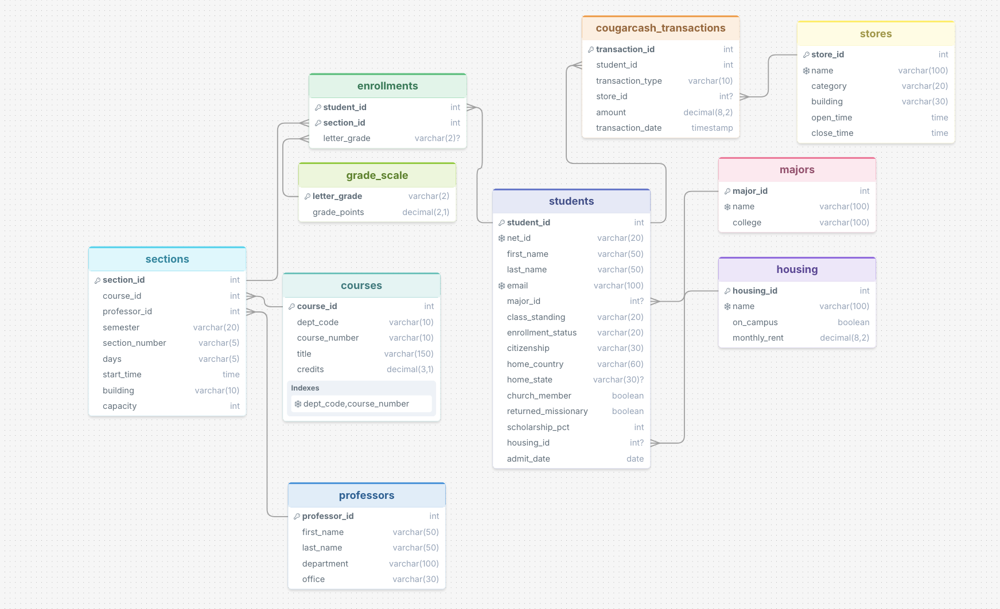

# BYU Student Records: ask a database questions in plain English

**Purpose:** A fictional BYU student records database (students, classes, grades, housing, and CougarCash spending at campus stores) that you can query in plain English. Claude turns your question into SQL, runs it on SQLite, and explains the result in plain English.

```
question ──► Claude writes SQL ──► SQLite runs it (read-only) ──► rows ──► Claude ──► plain-English answer
```

## Schema



10 tables, all with fictional data (`schema.sql` holds the tables, `data.sql` the rows):

| Table | Rows | What it holds |
|---|---|---|
| `students` | 20 | Major, class standing, enrollment status, citizenship, home country/state, church member, returned missionary, scholarship %, housing |
| `majors` | 12 | Major name and college |
| `housing` | 9 | On- and off-campus housing with monthly rent |
| `professors` | 14 | Name, department, office |
| `courses` | 20 | C S, MATH, STAT, REL A, WRTG, … with credits |
| `sections` | 38 | A course taught by a professor in a semester (Winter 2026 has grades, Fall 2026 is in progress) |
| `enrollments` | 56 | Student in a section, with letter grade (NULL = in progress) |
| `grade_scale` | 12 | Letter grade → grade points (BYU uses E for failing) |
| `stores` | 11 | Places that take CougarCash: Cougareat, Creamery on Ninth, BYU Store, HBLL print center, vending machines |
| `cougarcash_transactions` | 39 | Deposits and purchases; purchases link to a store |

GPA and CougarCash balance are deliberately **not stored**, so the model has to calculate them from the tables.

## A question that worked ✅

**Q:** *Who are the top 5 international students by GPA who have no scholarship, are returned missionaries, and have deposited CougarCash? Find the same for the top 5 national students.*

```sql
WITH student_gpa AS (
    SELECT s.student_id, s.first_name, s.last_name, s.citizenship,
           SUM(g.grade_points * c.credits) / SUM(c.credits) AS gpa
    FROM students s
    JOIN enrollments e ON e.student_id = s.student_id
    JOIN grade_scale g ON g.letter_grade = e.letter_grade
    JOIN sections sec ON sec.section_id = e.section_id
    JOIN courses c ON c.course_id = sec.course_id
    WHERE s.scholarship_pct = 0
      AND s.returned_missionary = 1
      AND EXISTS (SELECT 1 FROM cougarcash_transactions t
                  WHERE t.student_id = s.student_id AND t.transaction_type = 'Deposit')
    GROUP BY s.student_id, s.first_name, s.last_name, s.citizenship
)
SELECT * FROM (SELECT student_id, first_name, last_name, citizenship, ROUND(gpa, 3) AS gpa
               FROM student_gpa WHERE citizenship = 'International' ORDER BY gpa DESC LIMIT 5)
UNION ALL
SELECT * FROM (SELECT student_id, first_name, last_name, citizenship, ROUND(gpa, 3) AS gpa
               FROM student_gpa WHERE citizenship = 'US Citizen' ORDER BY gpa DESC LIMIT 5)
```

**Response:**
> **International students (top 3 found, fewer than 5 matched):** Sione Fifita 3.02, Hiroshi Tanaka 2.40, Wei Zhang 2.35.
> **National (US citizen) students (only 1 found):** Emma Johnson 1.70.
> Only 3 international students and 1 US citizen student met all the criteria, so neither group reaches 5.

Verified correct. It needed 5 tables, a credit-weighted GPA, and an `EXISTS` check so deposits didn't multiply the rows. It also said honestly that fewer than 5 students matched instead of loosening a filter.

## A question that did not work ❌

**Q:** *What classes is Emily Larsen taking right now?*

```sql
SELECT c.dept_code, c.course_number, c.title, sec.section_number, sec.semester, sec.days, sec.start_time, sec.building
FROM students s
JOIN enrollments e ON e.student_id = s.student_id
JOIN sections sec ON sec.section_id = e.section_id
JOIN courses c ON c.course_id = sec.course_id
WHERE s.first_name = 'Emily' AND s.last_name = 'Larsen'
  AND e.letter_grade IS NULL
```

**Response:**
> No matching records were found for Emily Larsen. … She may not be enrolled in anything right now, or there may be no student by that name in the records.

Emily Larsen is a **professor**. She's teaching MATH 112 and MATH 113 this semester. Because the question said "taking", Claude assumed she was a student and never checked the `professors` table. At least it didn't make anything up.

## More examples

[EXAMPLES.md](EXAMPLES.md) has 8 real questions with the generated SQL, the response, and a hand-checked verdict for each: 4 fully correct, 3 partly correct, 1 wrong.

## Prompting strategies

We tried all three strategies from [Chang & Fosler-Lussier (2023), *How to Prompt LLMs for Text-to-SQL*](https://arxiv.org/abs/2305.11853) (`prompts.py`):

| Strategy | What the prompt contains |
|---|---|
| **Zero-shot** | Our schema (`CREATE TABLE` statements plus 3 sample rows per table, the format the paper recommends) and the question |
| **Single-domain** | The same, plus 4 example question → SQL pairs written for *our* database (count by major, a professor's Fall classes, one student's credit-weighted GPA, spending by store category) |
| **Cross-domain** | 4 example question → SQL pairs from a *different* database (a campus piano tracking system), then our schema and the question |

`evaluate.py` runs 10 test questions through each strategy and grades the SQL automatically against a hand-written correct query. The full SQL for every run is in [strategy_results.md](strategy_results.md).

<!-- RESULTS: paste the summary table from strategy_results.md here after running `python evaluate.py` -->

| Strategy | Correct | Input tokens | Output tokens | Cost |
|---|---|---|---|---|
| zero-shot | _/10 | | | |
| single-domain | _/10 | | | |
| cross-domain | _/10 | | | |

**What we noticed:** _(fill in after running)_

## What we learned

- **How good is it at SQL?** Very good at the mechanics: joins across 5 tables, `NOT EXISTS`, `HAVING`, `CASE`, CTEs, and `UNION ALL` all came out right the first time. It was even careful about row multiplication on the hardest question.
- **Limitations:** The mistakes weren't syntax errors. They came from *understanding* the question:
  - It assumed a name belonged to a student.
  - It dropped students with no transactions when working out the lowest balance.
  - It reported a 1-student average as "the lowest" without a caveat.
  - It wrote an answer that was only as complete as the columns the SQL returned.
- **Cost:** About **1¢ per question** on `claude-sonnet-5-5` ($2 / $10 per million input/output tokens). Most of that is the roughly 3,800-token schema prompt. `claude-haiku-5-5` costs $0.10 / $0.50, roughly 20× cheaper. Running all 8 examples cost about $0.10.
- **Safety:** The database is opened read-only, and only single `SELECT`/`WITH` statements are allowed. Asking it to "add a student" is refused, because letting an AI write to a database is risky.

## Run it yourself

```bash
pip install -r requirements.txt
cp .env.example .env              # add your own Anthropic API key (never commit .env)
python app.py --init-db           # builds data/byu.db from schema.sql + data.sql
python app.py "Who spent the most CougarCash at the Creamery?"
python app.py --strategy single-domain "What is the average GPA by major?"
python app.py                     # interactive mode
python evaluate.py                # compare all three strategies
```

| File | Purpose |
|---|---|
| `app.py` | The natural-language interface |
| `prompts.py` | The three prompting strategies and their examples |
| `evaluate.py` | Automatic comparison of the strategies |
| `schema.sql`, `data.sql` | Database design and fictional data (`generate_data.py` regenerates the data) |
| `data/byu.db` | The built SQLite database |
| `EXAMPLES.md`, `strategy_results.md` | Results |
