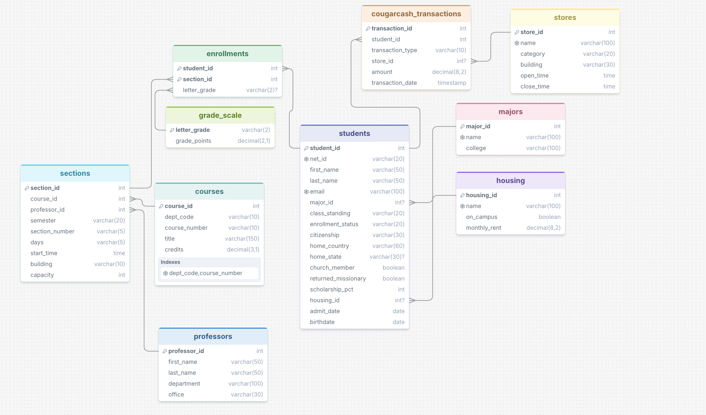

# BYU Student Records

## Schema



10 tables, all with fictional data (`schema.sql` holds the tables, `data.sql` the rows):

| Table | Rows | What it holds |
|---|---|---|
| `students` | 20 | Major, class standing, enrollment status, citizenship, home country/state, church member, returned missionary, scholarship %, housing |
| `majors` | 12 | Major name and college |
| `housing` | 9 | On- and off-campus housing with monthly rent |
| `professors` | 14 | Name, department, office |
| `courses` | 20 | C S, MATH, STAT, REL A, WRTG, … with credits |
| `sections` | 38 | A course taught by a professor in a semester (Winter 2026 has grades, Fall 2026 is in progress) |
| `enrollments` | 56 | Student in a section, with letter grade (NULL = in progress) |
| `grade_scale` | 12 | Letter grade → grade points (BYU uses E for failing) |
| `stores` | 11 | Places that take CougarCash: Cougareat, Creamery on Ninth, BYU Store, HBLL print center, vending machines |
| `cougarcash_transactions` | 39 | Deposits and purchases; purchases link to a store |

GPA and CougarCash balance are deliberately **not stored**, so the model has to calculate them from the tables.

## A question that worked 

**Q:** *Who are the top 5 international students by GPA who have no scholarship, are returned missionaries, and have deposited CougarCash? Find the same for the top 5 national students.*

```sql
WITH student_gpa AS (
    SELECT s.student_id, s.first_name, s.last_name, s.citizenship,
           SUM(g.grade_points * c.credits) / SUM(c.credits) AS gpa
    FROM students s
    JOIN enrollments e ON e.student_id = s.student_id
    JOIN grade_scale g ON g.letter_grade = e.letter_grade
    JOIN sections sec ON sec.section_id = e.section_id
    JOIN courses c ON c.course_id = sec.course_id
    WHERE s.scholarship_pct = 0
      AND s.returned_missionary = 1
      AND EXISTS (SELECT 1 FROM cougarcash_transactions t
                  WHERE t.student_id = s.student_id AND t.transaction_type = 'Deposit')
    GROUP BY s.student_id, s.first_name, s.last_name, s.citizenship
)
SELECT * FROM (SELECT student_id, first_name, last_name, citizenship, ROUND(gpa, 3) AS gpa
               FROM student_gpa WHERE citizenship = 'International' ORDER BY gpa DESC LIMIT 5)
UNION ALL
SELECT * FROM (SELECT student_id, first_name, last_name, citizenship, ROUND(gpa, 3) AS gpa
               FROM student_gpa WHERE citizenship = 'US Citizen' ORDER BY gpa DESC LIMIT 5)
```

**Response:**
> **International students (top 3 found, fewer than 5 matched):** Sione Fifita 3.02, Hiroshi Tanaka 2.40, Wei Zhang 2.35.
> **National (US citizen) students (only 1 found):** Emma Johnson 1.70.
> Only 3 international students and 1 US citizen student met all the criteria, so neither group reaches 5.

Verified correct. It needed 5 tables, a credit-weighted GPA, and an `EXISTS` check so deposits didn't multiply the rows. It also said honestly that fewer than 5 students matched instead of loosening a filter.

## A question that did not work 


**Q:** *Find active BYU students who are enrolled in at least 5 credits this semester, have a GPA higher than the average GPA for their major, and have spent more than the average in CougarCash. For each student, show their name, major, college, GPA, total credits this semester, total CougarCash spending, and number of courses.*

**Response:** no answer. The app crashed with:

```
sqlite3.OperationalError: incomplete input
```

This question needs several calculations in one query: current-semester credits, GPA, each major's average GPA, an average spending amount, and course counts. That adds up to a long query with several CTEs. The app capped Claude's reply at **1,024 output tokens**, so the SQL was cut off partway through. `incomplete input` is SQLite's error for a statement that stops in the middle. The automatic retry hit the same limit and failed the same way.

**What we changed:** we raised the limit to 4,096 tokens, and the app now detects a cut-off reply (`stop_reason == "max_tokens"`) and says so clearly instead of crashing. Even with the fix, this question has a second problem: "more than the average in CougarCash" doesn't say *whose* average (the whole school? their college? their major?), so the model has to guess.
## More examples

[EXAMPLES.md](EXAMPLES.md) has 8 real questions with the generated SQL, the response, and a hand-checked verdict for each: 4 fully correct, 3 partly correct, 1 wrong.

  
| Strategy | What the prompt contains |
|---|---|
| **Zero-shot** | Our schema (`CREATE TABLE` statements plus 3 sample rows per table, the format the paper recommends) and the question |
| **Single-domain** | The same, plus 4 example question → SQL pairs written for *our* database (count by major, a professor's Fall classes, one student's credit-weighted GPA, spending by store category) |
| **Cross-domain** | 4 example question → SQL pairs from a *different* database (a campus piano tracking system), then our schema and the question |

`evaluate.py` runs 10 test questions through each strategy and grades the SQL automatically against a hand-written correct query. The full SQL for every run is in [strategy_results.md](strategy_results.md).

## What I learned

- **How good is it at SQL?** Very good at the mechanics: joins across 5 tables, `NOT EXISTS`, `HAVING`, `CASE`, CTEs, and `UNION ALL` all came out right the first time. It was even careful about row multiplication on the hardest question.
- **Limitations:** The mistakes weren't syntax errors. They came from *understanding* the question:
  - It assumed a name belonged to a student.
  - It dropped students with no transactions when working out the lowest balance.
  - It reported a 1-student average as "the lowest" without a caveat.
  - It wrote an answer that was only as complete as the columns the SQL returned.

