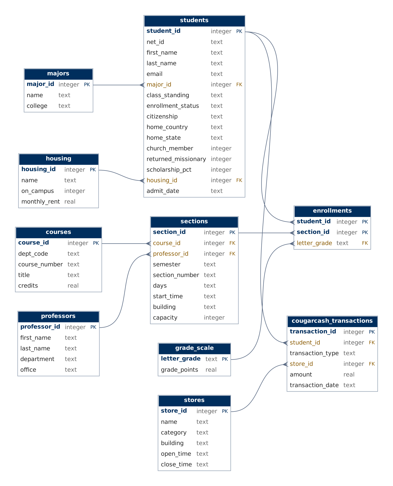

# BYU Student Records: AI + SQL natural-language interface

Ask questions about (fictional) BYU students in plain English and get answers in plain English.

```
question ──► Claude writes SQL ──► SQLite runs it (read-only) ──► rows ──► Claude ──► plain-English answer
```

## Database



| Table | What it holds |
|---|---|
| `students` | 60 students: major, class standing, enrollment status, citizenship, home country/state, church member, RM, scholarship %, housing |
| `majors` | 12 majors and their colleges |
| `housing` | On- and off-campus housing with monthly rent |
| `professors` | 14 professors and their departments/offices |
| `courses` | 20 courses (C S, MATH, STAT, REL A, WRTG, ...) with credits |
| `sections` | 70 course sections across Fall 2025, Winter 2026, Fall 2026 |
| `enrollments` | ~700 student-in-section records with letter grades (NULL = in progress, Fall 2026) |
| `grade_scale` | Letter grade → grade points (BYU uses E for failing) |
| `stores` | 11 places that take CougarCash: Cougareat, Creamery on Ninth, BYU Store, HBLL print center, vending machines, ... with category, building and hours |
| `cougarcash_transactions` | ~600 deposits and purchases; purchases link to a store (deposits have no store) |

All data is fictional. `schema.sql` holds the tables and `data.sql` the inserts.

## Setup

```bash
python3 -m venv .venv
source .venv/bin/activate
pip install -r requirements.txt
cp .env.example .env        # then paste your Anthropic API key into .env
python app.py --init-db     # builds data/byu.db from schema.sql + data.sql
```

## Use it

```bash
python app.py "Which international students are taking more than 15 credits this semester?"
python app.py                # interactive mode
python app.py --show-prompt  # see exactly what schema text is sent to Claude
```

Each answer prints the generated SQL, the row count, the answer, the time taken, and the token count so far.

## How it works

- **Schema prompt:** each table's `CREATE TABLE` statement plus 3 example rows, the format Chang & Fosler-Lussier (2023) found works best.
- **Safety:** the database is opened read-only, and the generated SQL must be a single `SELECT`/`WITH` statement.
- **Self-correction:** if the SQL fails, the error goes back to Claude once so it can fix the query.
- **Model:** set `ANTHROPIC_MODEL` in `.env` to compare models (e.g. `claude-sonnet-5-5` vs `claude-haiku-5-5`).

## Example questions

- Who spent the most CougarCash at the Creamery?
- What is the average GPA of returned missionaries vs. non-RMs?
- Which professor teaches the most sections in Fall 2026?
- How many students live on campus, and what's their average rent?
- Which courses had the most E grades last year?
- How much did students spend at vending machines, broken down by building?
- List Computer Science majors from outside the United States.
